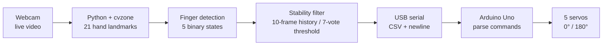

# Vision-Controlled Robotic Hand

**A webcam-to-servo prototype that tracks a human hand and controls five motors, one per finger.**

**Python** · **OpenCV / MediaPipe via cvzone** · **Arduino Uno** · **Embedded C++** · **Serial communication** · **Signal filtering**

> **Build status:** The webcam tracking, filtering, serial link, and five-servo electronics were built and tested. The complete mechanical hand structure was still a planned next step at the time of the project presentation. The controller currently supports **binary finger positions (0° or 180°)**, not continuous joint tracking.

### 🎥 Demonstration

**[Watch the hand-tracking demonstration](https://docs.google.com/file/d/1-BRF2H81tyz4TS4ig6DXwvBep5X_IxW4/preview)**

The demonstration recording shows the webcam processing a live hand as it moves between open and closed poses, with hand-landmark overlays updating in the preview and finger-state output appearing in the Python console. This illustrates the **computer-vision and gesture-classification stages** of the pipeline.

**Scope of the footage:** The video is a recording of the computer screen; it does **not** show physical servo motion or a completed mechanical hand. Servo-control implementation and wiring are documented separately below.

*The video is linked from my original project presentation. A smaller, GitHub-friendly MP4 copy is being prepared for the repository.*

## Why I built it

I wanted to connect three areas I was learning—**electronics, mechanics, and programming**—in one project where software had to respond to the physical world. The challenge was to take a noisy webcam observation of a moving hand, interpret five finger positions, and convert them into reliable commands for actual servo motors.

Rather than controlling every motor manually, I built an end-to-end sensing-to-actuation pipeline.

## System architecture



The important engineering problem wasn't just detecting a hand: it was making **noisy camera data trustworthy enough to drive physical hardware**.

## Hardware and wiring

| Component | Implementation |
| --- | --- |
| Controller | Arduino Uno |
| Actuators | Five servos, each controlling one finger |
| Servo signal pins | **3, 5, 6, 9, 10** |
| Servo power | Shared breadboard power rail rather than powering all motors from the Arduino 5 V pin |
| Ground | Shared ground between the servo rail and Arduino for a consistent signal reference |
| Connection to host | USB serial communication |

Power distribution and grounding mattered because multiple servos can draw substantial current at once. Separating their power rail from the Arduino's 5 V pin and maintaining a common ground were deliberate design choices.

## Software implementation

### 1. Detecting five finger states

The Python pipeline uses `cvzone.HandTrackingModule.HandDetector`, built on OpenCV and MediaPipe, to locate **21 hand landmarks** per frame.

I used simple geometric rules rather than training a custom gesture-recognition model:

- **Thumb:** compare the horizontal (`x`) position of the tip and nearby joint, because the thumb folds sideways
- **Index, middle, ring, and pinky:** compare the vertical (`y`) positions of each fingertip and a lower joint, because those fingers normally fold downward in the camera view
- Convert the comparisons into a **five-element list of 0/1 finger states**

This approach is straightforward to debug, though it depends on hand orientation and the camera view.

### 2. Filtering unstable readings

Raw frame-by-frame results sometimes flipped unexpectedly because of motion blur, lighting changes, or small hand movements. Those false state changes made the servos flicker between positions.

To reduce this, I implemented a **rolling history of 10 frames for each finger**, accepting an “up” state only when **at least 7 of the last 10 readings** agreed:

```python
HISTORY_SIZE = 10

for i in range(5):
    histories[i].append(fingers[i])
    if len(histories[i]) > HISTORY_SIZE:
        histories[i].pop(0)

    stable = 1 if sum(histories[i]) >= 7 else 0
    stability_check.append(stable)
```

*Illustrative excerpt of the filtering logic from the project presentation; the original program also handled the startup period before each history buffer was full.*

This made motor commands less sensitive to single-frame errors. It also introduced a trade-off: more stability means waiting for multiple frames before a finger-state change is accepted.

### 3. Sending commands to the Arduino

Python sends five comma-separated finger states over USB serial, ending each message with a newline.

**Example message:**

```text
1,0,0,1,0\n
```

The Arduino listens at **9600 baud**, reads a line with `Serial.readStringUntil('\n')`, and parses the five values using `sscanf()`. Each state is mapped to an endpoint angle:

```cpp
myServo1.write(thumb * 180);
myServo2.write(indexFinger * 180);
myServo3.write(middleFinger * 180);
myServo4.write(ringFinger * 180);
myServo5.write(pinky * 180);
```

The result is **independent binary control of five servo channels**. These code excerpts describe the tested prototype; continuous 0–180° tracking remains a future improvement.

## What I learned

| Challenge | Engineering takeaway |
| --- | --- |
| Single-frame detection flickered | Sensor readings need filtering before driving real actuators |
| Thumb geometry differs from other fingers | Different mechanisms can need different detection rules |
| Keeping camera updates and serial parsing aligned | A simple, well-defined line-based protocol is easier to inspect and debug |
| Multiple motors share power and signal references | Power distribution and common grounding are essential to dependable hardware control |

## Current scope and next steps

**Completed / demonstrated**
- Live webcam hand-landmark detection using cvzone / MediaPipe
- Per-finger geometric state detection
- 10-frame stability filtering with a 7-of-10 threshold
- Python-to-Arduino serial command pipeline
- Five individual servo outputs and supporting wiring

**Planned improvements**
- Build and integrate the full physical robotic-hand structure
- Replace binary 0°/180° states with proportional finger angles
- Evaluate a PCA9685 servo driver for more flexible multi-servo control
- Publish the original Python/Arduino source files and hardware photos alongside a reproducible setup guide

## Repository status

This repository currently contains the project documentation. The original Python and Arduino source files are being prepared for publication; **the short excerpts above are not a complete runnable implementation**.

---

*Personal project · Summer 2026*